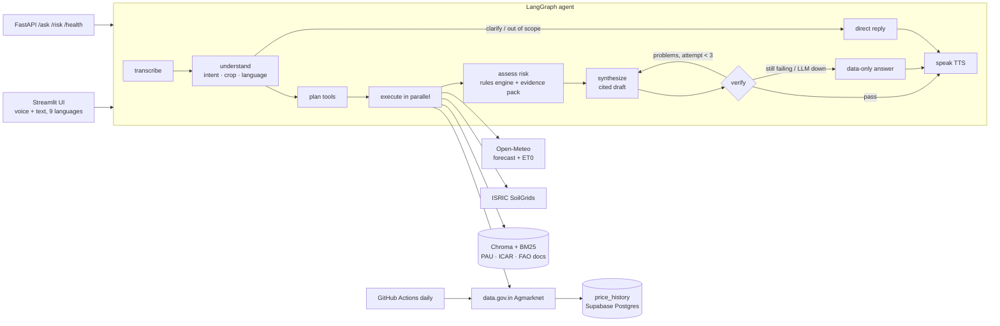

# 🌾 KisanSaathi — multilingual farm advisor agent

A farmer asks by **voice or text in their own language** — *"इस हफ्ते प्याज पर छिड़काव करूं?"* — and gets a short
spoken + written answer grounded in **live local weather, soil data, today's mandi prices and official crop guides**,
with **every fact cited** and **every number checked** before it is shown.

**Live demo:** https://kisansaathi-forge.streamlit.app/

Forge Gen AI Buildathon · Theme 2 — Climate, Resource Infrastructure & Global Supply Resilience ·
Problem: *Multilingual Agritech & Resource Advisory Assistant*.

## What makes it different from a chatbot

| | |
|---|---|
| **Agentic, not chatty** | A LangGraph state machine plans which tools to call, runs them in parallel, applies a deterministic rules engine, drafts, **verifies**, and self-corrects (up to 3 drafts). |
| **Verifier node** | Every number in the draft (incl. Devanagari/Indic digits) must exist in the evidence; every `[S#]` citation must exist; an LLM judge then checks claims. Fails → rewrite with the problems fed back → still failing → a data-only answer built straight from evidence. |
| **Cited agronomy rules** | 24 rules (11 quoted, 5 mixed, 8 operational) from **PAU Package of Practices**, **ICAR-DOGR**, **ICAR-IISR** and **FAO-56**, each with document + page + quote, and labelled *quoted* vs *operational*. |
| **Hyper-local** | Forecast, soil and crop stage for the farmer's own lat/lon and sowing date. Best spray window, crop water need (ET0 × Kc), harvest dry days. |
| **Own price history** | data.gov.in only serves today's prices, so a daily job stores snapshots → real trends for "sell now or hold?". |
| **Never crashes** | Every upstream has timeout + retry + last-good cache (shown as *cached · last updated …*). Gemini → Groq fallback. LLM fully down → keyword routing + data-only answers. |

## Architecture



### Tech stack

| Layer | Choice | Why |
|---|---|---|
| Agent | **LangGraph** state machine | Explicit nodes, conditional edges and a retry loop, easy to trace and test |
| LLMs | **Gemini** (`gemini-3.5-flash-lite`) → **Groq** (`openai/gpt-oss-120b`) | Free tiers; a failing model is put on cooldown and the next one answers |
| Voice | **Sarvam** (STT `saaras:v4`, TTS `bulbul:v3`) → Gemini / Groq Whisper → gTTS | Indian languages with free fallbacks |
| Knowledge | **Chroma** + multilingual MiniLM embeddings + **BM25**, merged by reciprocal rank fusion | Works across Hindi, Marathi and English questions |
| Rules | YAML (`data/rules.yaml`), each with document, page and quote | Deterministic, testable, citable |
| Data | Open-Meteo, ISRIC SoilGrids, data.gov.in Agmarknet | Live and official; no mock data |
| Storage | **Supabase Postgres** (SQLite fallback), diskcache for HTTP | Price history survives restarts; the app still runs if the DB is down |
| UI / API | **Streamlit**, **FastAPI** | Voice-first web app; REST for integrations |
| Hosting | Streamlit Community Cloud (Docker image also provided) | Free |

### Components

| Component | Responsibility |
|---|---|
| `agent/nodes.py` | The graph nodes: transcribe, understand, plan, execute (parallel), assess, synthesize, verify, fallback, speak |
| `agent/verify.py` | Code-level checks: every number and citation must exist in the evidence pack |
| `tools/rules.py` | Applies thresholds from `rules.yaml` to the forecast and crop stage; repeated low-severity alerts are shown once as a weekly note |
| `tools/crop_stage.py` | Crop stage and Kc from FAO-56, scaled to Indian-variety durations cited in `crops.yaml` |
| `http.py` + `cache.py` | Retry with backoff, fresh cache, and a last-good fallback labelled *cached*; tools never raise |
| `llm.py` | Provider chain with cooldowns and JSON validation with one repair attempt |
| `jobs/snapshot_prices.py` | Saves each day's mandi prices so trends come from real history |

### One request, end to end (be ready to explain this)
1. **Voice** → Sarvam *saaras:v4* STT (fallbacks: Gemini audio, then Groq Whisper) → transcript + language.
2. **understand** → LLM returns JSON: English translation, intents (`spray_timing`, `sell_or_hold`, …), crop, in-scope flag.
   If the LLM is down, keyword + script detection does this instead.
3. **plan** → deterministic intent→tool map (e.g. `sell_or_hold` → mandi prices + our price trend + weather + guides).
4. **execute** → tools run in parallel; each returns `ToolResult{data, source, fetched_at, is_cached, error}` and never raises.
5. **assess** → `rules.yaml` thresholds × forecast × crop stage → risk flags with citations; spray window & water need;
   everything numbered `S1…Sn` in an *evidence pack*.
6. **synthesize** → LLM writes ≤110 words in the farmer's language + English, citing `[S#]`, using only the pack.
7. **verify** → numbers/citations checked in code, then an LLM judge. Problems go back to step 6.
8. **speak** → Sarvam *bulbul* TTS (fallback: gTTS). The UI shows the answer, audio, sources and the full trace.

## Data sources (all live or official — no mock data)

| Need | Source | Key |
|---|---|---|
| 7-day forecast, humidity, wind, ET0, soil moisture | [Open-Meteo](https://open-meteo.com) | no |
| Geocoding / reverse geocoding | Open-Meteo Geocoding, OpenStreetMap Nominatim | no |
| Soil pH, organic carbon, texture, N, CEC | [ISRIC SoilGrids v2](https://soilgrids.org) (nearest farmland if the point is built-up) | no |
| Mandi prices | [Agmarknet via data.gov.in](https://data.gov.in/resource/current-daily-price-various-commodities-various-markets-mandi) | yes (free) |
| Price trend | our `price_history` table, filled daily from the above | — |
| Agronomy knowledge & thresholds | PAU Package of Practices (Rabi 2025-26, Kharif 2026, Vegetables 2021), ICAR-DOGR *Good Agricultural Practices in Onion & Garlic* (2022), ICAR-IISR Soybean Extension Bulletin 18 (2023) & Climate-Smart Soybean (2021), FAO Irrigation & Drainage Paper 56 | no |

Document list: `data/sources.yaml` · rules with page citations: `data/rules.yaml` · crop stages & Kc: `data/crops.yaml`.
The PDFs are downloaded from the publishers at build time and are not redistributed in this repo.

**Honesty rules in code:** tests may use recorded fixtures (`tests/fixtures/`, tests only); the app never shows a
number that did not come from a live API, our DB of real snapshots, or a cited rule. Missing data is stated, with the
Kisan Call Centre **1800-180-1551** as the fallback.

Supported crops: wheat, rice, cotton, soybean, onion, tomato, potato · Languages: हिन्दी, मराठी, English, ਪੰਜਾਬੀ,
தமிழ், తెలుగు, বাংলা, ಕನ್ನಡ, ગુજરાતી (UI labels in en/hi/mr; answers in all).

## Setup

### 1. Prerequisites
- Python **3.11**, Git, and about 2 GB of free disk (embedding model and PDFs).
- Free API keys: [Gemini](https://aistudio.google.com/apikey), [Groq](https://console.groq.com/keys),
  [data.gov.in](https://data.gov.in) (for mandi prices). Optional: [Sarvam](https://dashboard.sarvam.ai) (better Indian-language voice;
  Gemini/Groq/gTTS are used without it) and a [Supabase](https://supabase.com) project (shared price history).

### 2. Install and configure
```bash
git clone https://github.com/PratyushC290/kisansaathi.git && cd kisansaathi
uv venv --python 3.11 .venv && source .venv/bin/activate     # or: python3.11 -m venv .venv
uv pip install -r requirements.txt                           # or: pip install -r requirements.txt
cp .env.example .env                                         # then fill in the keys (table below)
```

| Setting (`.env`) | Needed? | What it does |
|---|---|---|
| `GEMINI_API_KEY` | One of Gemini or Groq | Writes and checks answers, audio fallback |
| `GROQ_API_KEY` | One of Gemini or Groq | Fallback model and Whisper speech-to-text |
| `DATA_GOV_IN_API_KEY` | For mandi prices | Agmarknet daily prices |
| `SARVAM_API_KEY` | Optional | Voice in and out for Indian languages |
| `DATABASE_URL` | Optional | Supabase Postgres. Use the **Session pooler** URI (`…pooler.supabase.com:5432`); the direct `db.*.supabase.co` host is IPv6-only. Empty means a local SQLite file |
| `WEATHER_URL`, `SOIL_URL`, `MANDI_URL`, … | Optional | Point one at `http://invalid` to test fallbacks |
| `GEMINI_MODEL`, `GEMINI_FAST_MODEL`, `GROQ_MODEL` | Optional | Override model names if they change |

### 3. First run
```bash
python -m kisansaathi.rag.ingest   # downloads the 7 official PDFs and builds the search index (~3 min, once)
python -m jobs.snapshot_prices     # saves today's mandi prices (about 7 data.gov.in calls)
streamlit run app/ui.py            # app on http://localhost:8501
uvicorn app.api:app --port 8000    # optional REST API; docs at http://localhost:8000/docs
```
Open the app, create a farmer in the **Profile** tab (search your village or use GPS, pick crops and sowing dates),
then use the **Ask** tab. On a fresh host with no index, the app builds it on first start.

CLI: `python -m kisansaathi.agent.graph "प्याज अभी बेचूं?" --farmer tests/demo_farmer.json`

### 4. Tests
```bash
pytest              # offline, no API calls (recorded fixtures live only in tests/)
pytest -m live      # hits the real APIs; uses a few calls
ruff check .
```

### 5. Robustness checks
Set `WEATHER_URL=http://invalid` in `.env`: the app shows the last saved forecast labelled *cached*.
Remove `GEMINI_API_KEY`: Groq answers. Remove both LLM keys: data-only answers with sources.

### Troubleshooting
| Problem | Fix |
|---|---|
| "knowledge base is empty" | Run `python -m kisansaathi.rag.ingest` |
| Database warning, app uses SQLite | Use the Supabase **Session pooler** URI, not the direct host |
| Mandi prices empty | data.gov.in returns nothing when called in quick bursts; wait a minute and retry |
| Model returns 404 or 503 | Model names change; set `GEMINI_MODEL` / `GROQ_MODEL`, or rely on the automatic fallback |
| No sound | Add `SARVAM_API_KEY`, or the app falls back to gTTS |

## Deploy

**Streamlit Community Cloud (used for the live demo).** Push the repo to GitHub, then at share.streamlit.io choose
*Create app*, repository `…/kisansaathi`, branch `main`, main file `app/ui.py`, Python 3.11. In *Advanced settings → Secrets* add:
```toml
GEMINI_API_KEY = "…"
GROQ_API_KEY = "…"
DATA_GOV_IN_API_KEY = "…"
SARVAM_API_KEY = "…"
DATABASE_URL = "postgresql://…pooler.supabase.com:5432/postgres"
```
The first start builds the search index (a few minutes).

**Docker / Hugging Face Spaces / Render.** The `Dockerfile` builds the index at image build time and serves on `$PORT` (7860).
Note: Hugging Face now needs a PRO plan for Docker Spaces.

**Daily price snapshots.** `.github/workflows/daily_snapshot.yml` runs the job twice a day if `DATA_GOV_IN_API_KEY` and
`DATABASE_URL` are set as GitHub Actions secrets. data.gov.in may block GitHub's servers; if the workflow times out, run
`python -m jobs.snapshot_prices` from any machine once a day instead. Trends appear after two or more days of records,
and the direction label after three.

## Repository map
```
kisansaathi/  config · models · http (retry+cache) · db · llm (Gemini→Groq) · speech · translate · health · dashboard
  tools/      weather · soil · mandi · geocode · crop_stage · knowledge (hybrid RAG) · rules
  agent/      state · prompts · nodes · verify · graph
  rag/        ingest
app/          ui.py (Streamlit) · api.py (FastAPI) · i18n.py
jobs/         snapshot_prices.py
data/         sources.yaml · rules.yaml · crops.yaml
tests/        rules · verifier · graph · robustness · translate · ui (all offline) · tools_live (real APIs)
```

## Team
**Team Harnessers** — Pratyush Chandra, Satyaprakash Kar, Abhiram Parupudi.
