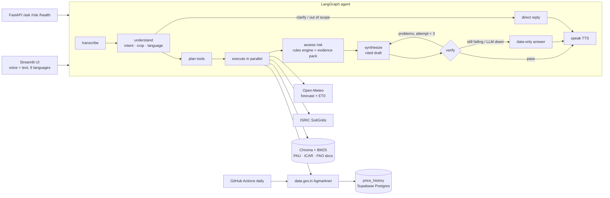

# 🌾 KisanSaathi — multilingual farm advisor agent

A farmer asks by **voice or text in their own language** — *"इस हफ्ते प्याज पर छिड़काव करूं?"* — and gets a short
spoken + written answer grounded in **live local weather, soil data, today's mandi prices and official crop guides**,
with **every fact cited** and **every number checked** before it is shown.

Forge Gen AI Buildathon · Theme 2 — Climate, Resource Infrastructure & Global Supply Resilience ·
Problem: *Multilingual Agritech & Resource Advisory Assistant*.

## What makes it different from a chatbot

| | |
|---|---|
| **Agentic, not chatty** | A LangGraph state machine plans which tools to call, runs them in parallel, applies a deterministic rules engine, drafts, **verifies**, and self-corrects (up to 3 drafts). |
| **Verifier node** | Every number in the draft (incl. Devanagari/Indic digits) must exist in the evidence; every `[S#]` citation must exist; an LLM judge then checks claims. Fails → rewrite with the problems fed back → still failing → a data-only answer built straight from evidence. |
| **Cited agronomy rules** | 24 rules (11 quoted, 5 mixed, 8 operational) from **PAU Package of Practices**, **ICAR-DOGR**, **ICAR-IISR** and **FAO-56**, each with document + page + quote, and labelled *quoted* vs *operational*. |
| **Hyper-local** | Forecast, soil and crop stage for the farmer's own lat/lon and sowing date. Best spray window, crop water need (ET0 × Kc), harvest dry days. |
| **Own price history** | data.gov.in only serves today's prices, so a daily job stores snapshots → real trends for "sell now or hold?". |
| **Never crashes** | Every upstream has timeout + retry + last-good cache (shown as *cached · last updated …*). Gemini → Groq fallback. LLM fully down → keyword routing + data-only answers. |

## Architecture



### One request, end to end (be ready to explain this)
1. **Voice** → Sarvam *saarika* STT (fallback: Gemini audio) → transcript + language.
2. **understand** → LLM returns JSON: English translation, intents (`spray_timing`, `sell_or_hold`, …), crop, in-scope flag.
   If the LLM is down, keyword + script detection does this instead.
3. **plan** → deterministic intent→tool map (e.g. `sell_or_hold` → mandi prices + our price trend + weather + guides).
4. **execute** → tools run in parallel; each returns `ToolResult{data, source, fetched_at, is_cached, error}` and never raises.
5. **assess** → `rules.yaml` thresholds × forecast × crop stage → risk flags with citations; spray window & water need;
   everything numbered `S1…Sn` in an *evidence pack*.
6. **synthesize** → LLM writes ≤110 words in the farmer's language + English, citing `[S#]`, using only the pack.
7. **verify** → numbers/citations checked in code, then an LLM judge. Problems go back to step 6.
8. **speak** → Sarvam *bulbul* TTS (fallback: gTTS). The UI shows the answer, audio, sources and the full trace.

## Data sources (all live or official — no mock data)

| Need | Source | Key |
|---|---|---|
| 7-day forecast, humidity, wind, ET0, soil moisture | [Open-Meteo](https://open-meteo.com) | no |
| Geocoding / reverse geocoding | Open-Meteo Geocoding, OpenStreetMap Nominatim | no |
| Soil pH, organic carbon, texture, N, CEC | [ISRIC SoilGrids v2](https://soilgrids.org) (nearest farmland if the point is built-up) | no |
| Mandi prices | [Agmarknet via data.gov.in](https://data.gov.in/resource/current-daily-price-various-commodities-various-markets-mandi) | yes (free) |
| Price trend | our `price_history` table, filled daily from the above | — |
| Agronomy knowledge & thresholds | PAU Package of Practices (Rabi 2025-26, Kharif 2026, Vegetables 2021), ICAR-DOGR *Good Agricultural Practices in Onion & Garlic* (2022), ICAR-IISR Soybean Extension Bulletin 18 (2023) & Climate-Smart Soybean (2021), FAO Irrigation & Drainage Paper 56 | no |

Document list: `data/sources.yaml` · rules with page citations: `data/rules.yaml` · crop stages & Kc: `data/crops.yaml`.
The PDFs are downloaded from the publishers at build time and are not redistributed in this repo.

**Honesty rules in code:** tests may use recorded fixtures (`tests/fixtures/`, tests only); the app never shows a
number that did not come from a live API, our DB of real snapshots, or a cited rule. Missing data is stated, with the
Kisan Call Centre **1800-180-1551** as the fallback.

Supported crops: wheat, rice, cotton, soybean, onion, tomato, potato · Languages: हिन्दी, मराठी, English, ਪੰਜਾਬੀ,
தமிழ், తెలుగు, বাংলা, ಕನ್ನಡ, ગુજરાતી (UI labels in en/hi/mr; answers in all).

## Run locally

```bash
uv venv --python 3.11 .venv && source .venv/bin/activate
uv pip install -r requirements.txt
cp .env.example .env            # add GEMINI_API_KEY, GROQ_API_KEY, DATA_GOV_IN_API_KEY, (SARVAM_API_KEY, DATABASE_URL)
python -m kisansaathi.rag.ingest   # downloads official guides, builds the index (~3 min first time)
python -m jobs.snapshot_prices     # first price snapshot
streamlit run app/ui.py            # app on http://localhost:8501
uvicorn app.api:app --port 8000    # optional REST API (/docs)
```

CLI: `python -m kisansaathi.agent.graph "प्याज अभी बेचूं?" --farmer tests/demo_farmer.json`

Tests: `pytest` (offline) · `pytest -m live` (real APIs) · `ruff check .`

Robustness demo: set `WEATHER_URL=http://invalid` in `.env` → the app shows last saved forecast labelled *cached*;
remove `GEMINI_API_KEY` → Groq answers; remove both LLM keys → data-only answers.

## Deploy (Hugging Face Spaces)
Create a Space with **Docker** SDK, push this repo, and add the `.env` keys as Space secrets. The image builds the
knowledge base at build time. Database: set `DATABASE_URL` to a Supabase Postgres URI (Space disk is wiped on restart).
Daily price snapshots: add `DATA_GOV_IN_API_KEY` and `DATABASE_URL` as GitHub Actions secrets.

## Repository map
```
kisansaathi/  config · models · http (retry+cache) · db · llm (Gemini→Groq) · speech · health · dashboard
  tools/      weather · soil · mandi · geocode · crop_stage · knowledge (hybrid RAG) · rules
  agent/      state · prompts · nodes · verify · graph
  rag/        ingest
app/          ui.py (Streamlit) · api.py (FastAPI) · i18n.py
jobs/         snapshot_prices.py
data/         sources.yaml · rules.yaml · crops.yaml
tests/        rules · verifier · graph (offline) · tools_live
```

## Team
_Add team member names here._
